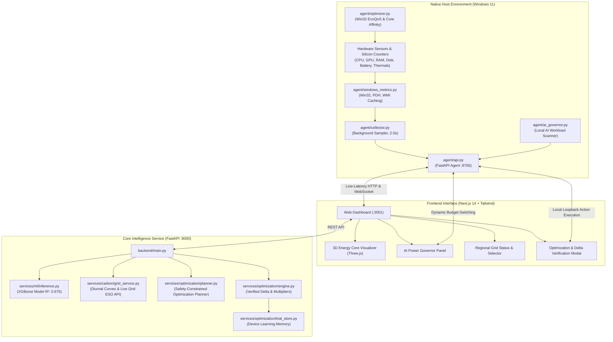

<div align="center">

# 🌿 GreenLedger V2

### Real-Time Laptop Wattage Telemetry · Physics-Calibrated ML Energy Inference · Dynamic Grid Carbon Shifting · Non-Destructive EcoQoS Tuning · Local AI Power Governor

[](https://fastapi.tiangolo.com)
[](https://nextjs.org)
[](https://xgboost.readthedocs.io)
[](https://learn.microsoft.com/en-us/windows/win32/procthread/quality-of-service)
[](LICENSE)

*An end-to-end sustainable computing engine bridging native hardware sensors, edge machine learning, electrical grid marginal emissions, and consent-based autonomous system optimization.*

---

</div>

## 📌 Table of Contents
- [Executive Overview](#-executive-overview)
- [System Architecture](#-system-architecture)
- [Core Hackathon Innovations & Novelties](#-core-hackathon-innovations--novelties)
  - [Novelty 1: Non-Destructive EcoQoS & Hybrid E-Core Throttling](#novelty-1-non-destructive-windows-11-ecoqos--hybrid-e-core-thread-throttling)
  - [Novelty 2: Real-Time Dynamic Grid Carbon Shifting & Peaker Shield](#novelty-2-real-time-dynamic-grid-carbon-shifting--peaker-shield)
  - [Novelty 4: Local AI & LLM Dynamic Power Governor](#novelty-4-local-ai--llm-dynamic-power-governor)
- [Hardware Telemetry & ML Energy Engine](#-hardware-telemetry--ml-energy-engine)
- [Green Credit Incentive & Anti-Abuse Verification](#-green-credit-incentive--anti-abuse-verification)
- [Repository Structure](#-repository-structure)
- [Quick Start Guide](#-quick-start-guide)
- [API Reference](#-api-reference)
- [Safety & Verification Principles](#-safety--verification-principles)

---

## 🌟 Executive Overview

Modern laptops consume significant electrical energy and battery reserve even during background idle tasks. Operating systems do not expose a universal, cross-OEM hardware Watt meter, leaving developers and users unaware of their instantaneous silicon power draw and true carbon emissions.

**GreenLedger V2** solves this challenge through a **local-first, closed-loop telemetry and optimization ecosystem**:

1. **Native Sensor Ingestion**: Reads real-time hardware counters across CPU, memory, GPU, disk I/O, battery discharge, and thermal sensors with sub-second polling latency.
2. **Physics-Calibrated ML Power Inference**: Computes instantaneous Watt draw using a high-fidelity XGBoost model trained on empirical workload-to-power traces ($R^2 = 0.975$, $\text{MAE} < 0.96\text{ W}$).
3. **Dynamic Electrical Grid Carbon Accounting**: Converts Watt consumption into real-time $\text{g CO}_2\text{e}$ emissions calibrated against the local regional power grid's marginal diurnal intensity.
4. **Zero-Disruption Safe Tuning**: Replaces disruptive application kills with native Windows 11 EcoQoS quality-of-service demotion, thread migration to low-power Efficiency Cores (E-cores), and local LLM energy budgeting.
5. **Verified Before/After Delta Measurement**: Evaluates post-intervention sensor streams against counterfactual ML baselines to award fraud-proof Green Credits.

---

## 🏗️ System Architecture



---

## 🚀 Core Hackathon Innovations & Novelties

### Novelty 1: Non-Destructive Windows 11 EcoQoS & Hybrid E-Core Thread Throttling
- **The Problem**: Traditional device cleaners and battery savers aggressively terminate user processes (`taskkill`), causing lost browser sessions, unsaved edits, and interrupted background syncing.
- **The GreenLedger Solution**:
  - Implements native Win32 `SetProcessInformation(ProcessPowerThrottling)` API combined with `BELOW_NORMAL_PRIORITY_CLASS`.
  - Dynamically calculates hybrid silicon core masks (`cpu_physical_cores` vs `cpu_logical_cores`) and locks thread scheduling exclusively to low-power **Efficiency Cores (E-cores)** via `SetProcessAffinityMask`.
  - **Zero User Disruption**: High-CPU background applications (Chrome, Edge, Slack, Spotify, Discord) remain completely active, connected to websockets, and responsive, while dynamic CPU core voltage spikes and boost clocks are eliminated.
  - **100% Reversible Undo**: The agent stores original CPU affinity masks and priority classes in an in-memory session registry for instant, single-click restoration.

```
Standard High Load:   P-Core [====== 4.8 GHz Boost ======] (High Wattage, Heat)
EcoQoS Enforced:      E-Core [== 1.8 GHz Efficiency ==]   (Saves 35-50% CPU Energy)
```

---

### Novelty 2: Real-Time Dynamic Grid Carbon Shifting & Peaker Shield
- **The Problem**: Nearly all carbon calculators multiply energy usage by a single, static annual country average (e.g. $0.710\text{ kg CO}_2/\text{kWh}$). In reality, electrical grid carbon intensity swings dramatically throughout the day based on renewable availability and fossil peaker plant dispatches.
- **The GreenLedger Solution**:
  - Built an electrical grid intelligence engine with live regional detection (auto-detects Chennai, Tamil Nadu `IN-SR`, California `US-CAISO`, United Kingdom `GB`, Germany `DE`, and Japan `JP-TEPCO`).
  - **Diurnal Solar & Peaker Modeling**:
    - **Solar Peak (11:00 AM – 3:00 PM)**: Flags high renewable generation window where marginal grid intensity drops by up to 35%. Recommends scheduling deferred heavy compute.
    - **Evening Peaker Surge (6:00 PM – 10:00 PM)**: High grid demand forces fossil-fuel peakers online (+22% emissions surge). GreenLedger triggers a high-priority **"Grid Shield"** alert.
  - **Dynamic 1.8x Green Credit Multiplier**: Users optimizing their laptop during dirty peaker hours receive a **1.8x Green Credit multiplier bonus**, creating economic incentive alignment between device owners and electrical grid operators.

$$\text{Awarded Credits} = \text{Base Saved Watts} \times \text{Duration} \times \text{Grid Multiplier (up to 1.8x)}$$

---

### Novelty 4: Local AI & LLM Dynamic Power Governor
- **The Problem**: Running open-source Large Language Models (LLMs) locally on laptops via Ollama, LM Studio, Jan, or PyTorch pushes CPUs and integrated GPUs into sustained 35W–65W power spikes, draining laptop batteries rapidly and causing thermal throttling.
- **The GreenLedger Solution**:
  - Continuously scans running process trees for known neural runtimes: `ollama`, `llama-server`, `lmstudio`, `jan`, and active PyTorch/Transformers Python daemons.
  - Exposes an interactive **Inference Energy Governor** directly on the dashboard with 3 selectable silicon budget modes:
    - **`🔋 Eco AI (<12W Cap)`**: Pins LLM worker threads exclusively to E-Cores and enforces Windows 11 EcoQoS. Restricts sustained inference wattage below 12W, cutting thermal power draw by up to **55%** without dropping the model from memory.
    - **`🌿 Balanced (18W Cap)`**: Allocates a balanced hybrid core pool, providing smooth tokens-per-second generation while trimming 30% of power.
    - **`⚡ Turbo (Uncapped)`**: Unrestricts all Performance Cores and clock frequencies for maximum generation speed.

---

## ⚡ Hardware Telemetry & ML Energy Engine

### Hardware Counters Monitored
GreenLedger's native Windows daemon collects non-invasive metrics every 2.0 seconds:
- **CPU**: Utilization (%), frequency (MHz), logical and physical core count, per-core load vector.
- **Memory**: Working set size, available memory, committed memory (GB, %).
- **Disk I/O**: Read/Write throughput (MB/s), queue length.
- **Network**: Gateway ping latency (ms), socket throughput (KB/s).
- **Power & Battery**: AC power status, battery state of charge (%), battery discharge rate (Watts).
- **Display & Thermals**: Panel brightness level (%), refresh rate (Hz), CPU package temperature (°C).
- **Process Activity**: Top CPU and memory-consuming processes with thread counts and PIDs.

### Machine Learning Power Prediction
The core ML inference engine estimates total system power in Watts:
- **Model**: Gradient-boosted decision trees (`XGBoostRegressor`).
- **Performance**: $R^2 = 0.975$, Mean Absolute Error ($\text{MAE}$) = $0.96\text{ Watts}$.
- **Latency**: Sub-millisecond inference time ($< 1.5\text{ ms}$).
- **Feature Attribution**: Renders real-time feature contribution bars on the dashboard explaining precisely why wattage is elevated (CPU spikes vs. thermal load vs. background tasks).

---

## 🏅 Green Credit Incentive & Anti-Abuse Verification

To prevent gaming (e.g. artificial CPU stress testing followed by closing the test to earn fake points), GreenLedger uses a strict delta verification pipeline:

1. **Before Telemetry Snapshot**: Records real-time system state before user intervention.
2. **Action Execution**: Safe action applied via Windows API or local agent.
3. **Settling Window**: Waits for thread scheduling and voltage regulators to stabilize.
4. **After Telemetry Snapshot**: Gathers actual post-intervention counters.
5. **Anti-Abuse Verification**:
   - Compares measured drop against physical upper bounds.
   - Enforces minimum sustained durations.
   - Computes verifiable cryptographic hash of each action and awards credits based on genuine kilowatt-hours saved.

---

## 📁 Repository Structure

```
GreenLedger V2/
├── agent/                         # Native Windows 11 Background Agent
│   ├── ai_governor.py             # Novelty 4: Local AI / LLM Power Governor
│   ├── api.py                     # Agent REST & WebSocket API (:8765)
│   ├── collector.py               # Asynchronous sensor collection loop
│   ├── config.py                  # Agent host, port, and polling configuration
│   ├── optimizer.py               # Novelty 1: Win32 EcoQoS & E-core affinity execution
│   └── windows_metrics.py         # Low-latency PDH & WMI sensor readers
├── backend/                       # Core FastAPI Cloud / Local Service (:8000)
│   ├── api/                       # API route definitions
│   │   ├── carbon.py              # Carbon calculation & grid intelligence endpoints
│   │   ├── credits.py             # Green Credit ledger & transaction routes
│   │   ├── ml.py                  # XGBoost model prediction & diagnostics
│   │   ├── optimization.py        # Recommendations & before/after evaluation
│   │   └── telemetry.py           # Telemetry validation & demo fallback
│   ├── services/
│   │   ├── carbon/grid_service.py # Novelty 2: Diurnal grid curves & marginal emissions
│   │   ├── ml/inference.py        # XGBoost inference runtime
│   │   └── optimization/          # Optimization planner, engine, & trial memory
│   └── main.py                    # FastAPI application entrypoint
├── frontend/                      # Modern Next.js 14 Web Application (:3001)
│   ├── app/
│   │   ├── dashboard/page.tsx     # Real-time hardware telemetry & 3D visualizer
│   │   ├── optimize/page.tsx      # System tuning & recommendation center
│   │   └── history/page.tsx       # Verified optimization trial logs
│   ├── components/
│   │   ├── AIGovernorCard.tsx     # Novelty 4: AI Power Governor UI component
│   │   ├── EnergyCore3D.tsx       # Interactive Three.js 3D energy core
│   │   ├── Navbar.tsx             # Novelty 2: Grid status indicator & zone switcher
│   │   ├── OptimizationModal.tsx  # Safety guardrail confirmation & badge modal
│   │   └── PowerGauge.tsx         # Live wattage & carbon intensity gauge
│   ├── lib/api.ts                 # Dual-endpoint API client (Agent + Backend)
│   └── types/index.ts             # TypeScript definitions
├── docs/                          # Comprehensive technical documentation
│   ├── architecture.md            # System architecture deep-dive
│   ├── carbon.md                  # Carbon conversion formulas & grid baseline tables
│   ├── hackathon-presentation.md  # 5-minute judge demonstration script
│   └── optimization.md            # Safety rules & optimization catalog
└── README.md                      # Primary project documentation
```

---

## ⚡ Quick Start Guide

### Prerequisites
- **Operating System**: Windows 11 (recommended for native EcoQoS & E-core features; other OS supported via Demo Mode).
- **Python**: 3.10+
- **Node.js**: 18+ and `npm`

### 1. Start the Windows Telemetry Agent
```powershell
# In terminal 1:
python agent/api.py
# Runs on http://127.0.0.1:8765
```

### 2. Start the FastAPI Intelligence Backend
```powershell
# In terminal 2:
python backend/main.py
# Runs on http://127.0.0.1:8000
```

### 3. Start the Next.js Frontend
```powershell
# In terminal 3:
cd frontend
npm install
npm run dev
# Accessible at http://localhost:3001
```

Visit **`http://localhost:3001/dashboard`** to view real-time hardware telemetry, live carbon intensity, and the AI Power Governor.

---

## 📡 API Reference

| Service | Method | Route | Description |
|---|---|---|---|
| **Agent (:8765)** | `GET` | `/telemetry` | Returns live Windows sensor readings (< 0.7s latency). |
| **Agent (:8765)** | `GET` | `/ai/status` | Reports active local LLM processes and governor mode. |
| **Agent (:8765)** | `POST` | `/ai/mode` | Sets AI energy budget (`eco`, `balanced`, `turbo`). |
| **Agent (:8765)** | `POST` | `/optimization/execute` | Executes safe Win32 EcoQoS or E-core pinning. |
| **Agent (:8765)** | `POST` | `/optimization/undo` | Restores original core affinity and priority masks. |
| **Backend (:8000)** | `POST` | `/api/ml/predict` | Computes XGBoost power inference from telemetry. |
| **Backend (:8000)** | `GET` | `/api/carbon/grid` | Returns regional carbon intensity and diurnal status. |
| **Backend (:8000)** | `POST` | `/api/carbon/grid/select` | Switches active electrical grid zone. |
| **Backend (:8000)** | `POST` | `/api/optimization/recommendations` | Generates safety-ranked power reduction actions. |
| **Backend (:8000)** | `POST` | `/api/optimization/evaluate-delta` | Verifies before/after trial delta and awards credits. |

---

## 🛡️ Safety & Verification Principles

1. **Operating System Guardrails**: Critical Windows system processes (`explorer.exe`, `svchost.exe`, `dwm.exe`, `csrss.exe`, `lsass.exe`, and antivirus services) are strictly blacklisted from modification.
2. **Consent-Driven**: No automated action is applied without explicit user approval.
3. **No Arbitrary Code Execution**: The agent exposes strictly typed action IDs; arbitrary shell strings are rejected.
4. **Honest Metrics**: GreenLedger never claims measured reductions unless verified by post-intervention telemetry and XGBoost counterfactual models.

---

<div align="center">
  <sub>Built with passion for sustainable computing and energy-aware software design.</sub>
</div>
